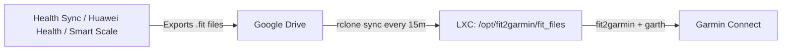

# gdrive2garmin

An automated **Proxmox VE LXC Container** script that synchronizes `.fit` activity/health files from **Google Drive** (via `rclone`) and automatically uploads them to **Garmin Connect** using [`fit2garmin`](https://github.com/Jacopo1891/fit2garmin) and [`garth`](https://github.com/matin/garth).

Built following the official [Community-Scripts / Proxmox VE Helper-Scripts](https://github.com/community-scripts/ProxmoxVE) orchestration standard.

---

## 🚀 Workflow Overview



1. External health devices or apps (e.g. Huawei Health via Health Sync) export `.fit` files to a designated Google Drive folder.
2. The LXC container runs an automated cron job every 15 minutes to sync new `.fit` files using `rclone`.
3. `fit2garmin` reads new files and uploads them directly to your Garmin Connect account.

---

## 📦 Container Specifications

| Setting | Default Value | Description |
| :--- | :--- | :--- |
| **OS** | Debian 12 (Bookworm) | Minimal base container |
| **CPU Cores** | 1 Core | Low overhead |
| **RAM** | 512 MB | Lightweight footprint |
| **Disk Size** | 4 GB | Ample space for packages and `.fit` cache |
| **Privileges** | Unprivileged (`1`) | Enhanced security |

---

## 🛠️ Installation

Run the following command in your **Proxmox VE Node Shell**:

```bash
bash -c "$(curl -fsSL https://raw.githubusercontent.com/dngoyb/gdrive2garmin/main/ct/gdrive2garmin.sh)"
```

---

## ⚙️ Post-Installation Configuration

Because Garmin credentials and Google Drive OAuth authentication require user interaction, an interactive setup wizard is provided inside the container.

### Method 1: Interactive Setup Wizard (Recommended)

1. **Access the Container Console** (from your Proxmox host shell):
   ```bash
   pct enter <CTID>
   ```
   *(Replace `<CTID>` with the container ID shown upon creation, e.g. `pct enter 105`)*

2. **Run the Setup Wizard**:
   Inside the container, either run:
   ```bash
   gdrive2garmin-setup
   ```
   Or paste this single-line command:
   ```bash
   bash -c "$(curl -fsSL https://raw.githubusercontent.com/dngoyb/gdrive2garmin/main/setup.sh)"
   ```

3. **Follow the interactive prompts**:
   - **Garmin Credentials**: Prompts for your Garmin email & password (supports 2FA/MFA if enabled on your Garmin account).
   - **Google Drive Authentication**: Easily authorize Google Drive via token or guided `rclone config`, and select your remote `.fit` folder.
   - **Verification**: Automatically tests Garmin authentication, checks files in Google Drive, and offers an immediate test sync.

---

### Method 2: Manual Configuration

If you prefer configuring credentials and remotes manually:

#### 1. Set Up Garmin Credentials
Edit `/opt/fit2garmin/config.py`:
```bash
nano /opt/fit2garmin/config.py
```

Update your Garmin account details:
```python
debug = True

garmin_email = "your_garmin_email@example.com"
garmin_password = "your_garmin_password"

folder_path = "/opt/fit2garmin/fit_files"
session_file_path = "~/.garth"
```
Save and exit (`Ctrl+O`, `Enter`, `Ctrl+X`).

#### 2. Authenticate Google Drive via `rclone`
Run the interactive `rclone` configuration:
```bash
rclone config
```

1. Press `n` for **New remote**.
2. Name the remote: `gdrive` *(matches default script setting)*.
3. Storage type: Select `drive` (Google Drive).
4. Leave `client_id` and `client_secret` blank (or provide your own Google Cloud API credentials).
5. Scope: Choose `1` (Full access).
6. When prompted for **Use web browser to automatically authenticate**, choose `n` (headless / remote machine).
7. Follow the on-screen instructions to authorize via your desktop browser (`rclone authorize "drive"`) and paste the returned verification token.
8. Confirm and save the remote (`q` to quit config).

#### 3. Verify & Test Synchronization
Test the sync script manually:
```bash
/opt/fit2garmin/sync.sh
```

Check the sync logs:
```bash
tail -f /var/log/gdrive2garmin.log
```

---

## ⏰ Automation & Scheduling

The installation automatically deploys a cron job in `/etc/cron.d/gdrive2garmin`:

```cron
*/15 * * * * root /opt/fit2garmin/sync.sh >> /var/log/gdrive2garmin.log 2>&1
```

- **Frequency**: Every 15 minutes.
- **Log file**: `/var/log/gdrive2garmin.log`.
- To modify the interval or target Google Drive folder, customize `/etc/cron.d/gdrive2garmin` or edit `/opt/fit2garmin/sync.env`.

---

## 📁 Repository Structure

```
.
├── ct/
│   └── gdrive2garmin.sh          # Proxmox LXC creation & orchestration script
├── install/
│   ├── gdrive2garmin-install.sh  # In-container setup, packages & configuration
│   └── setup.sh                  # In-container setup wizard implementation
├── setup.sh                      # One-line entrypoint for setup wizard inside LXC
└── README.md                     # Documentation
```

---

## 🔄 Updates & Maintenance

To update the container's `fit2garmin` scripts and dependencies in the future, run the creation script again or execute:

```bash
cd /opt/fit2garmin
git pull
pip3 install --upgrade --break-system-packages garth
```

---

## 📜 Credits

- [`fit2garmin`](https://github.com/Jacopo1891/fit2garmin) by [Jacopo1891](https://github.com/Jacopo1891)
- [`garth`](https://github.com/matin/garth) by [Matin](https://github.com/matin)
- Base orchestration inspired by [Community-Scripts / Proxmox VE Helper-Scripts](https://github.com/community-scripts/ProxmoxVE)

---

## ⚖️ License

Distributed under the [MIT License](https://opensource.org/licenses/MIT).
